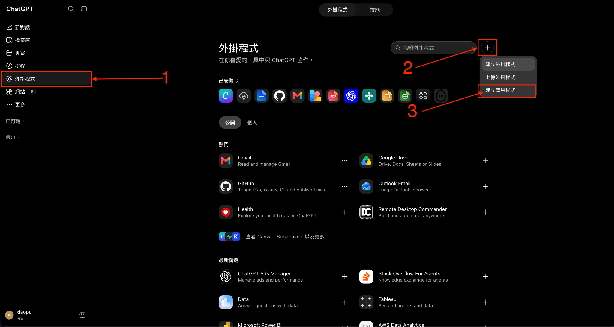
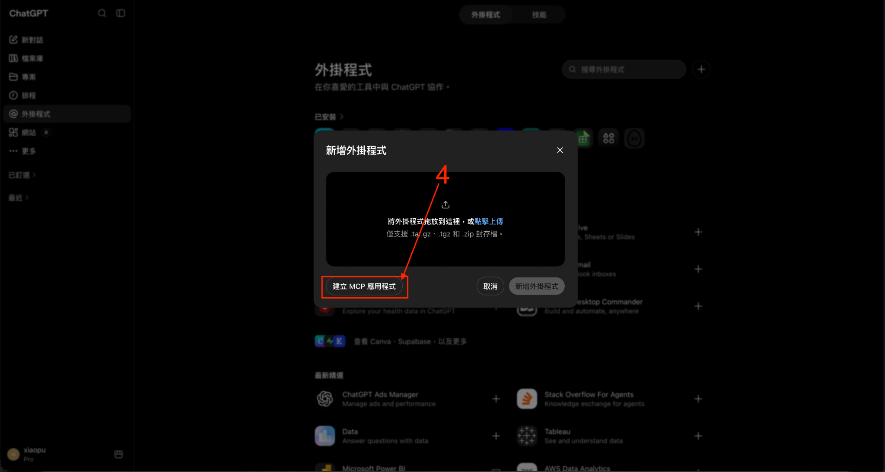
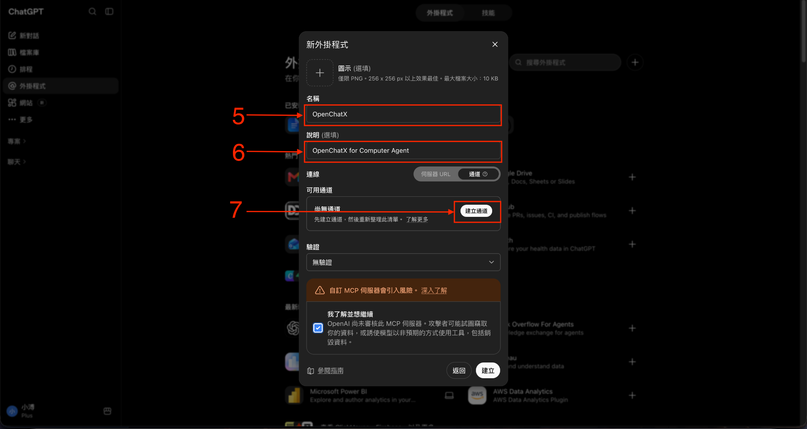
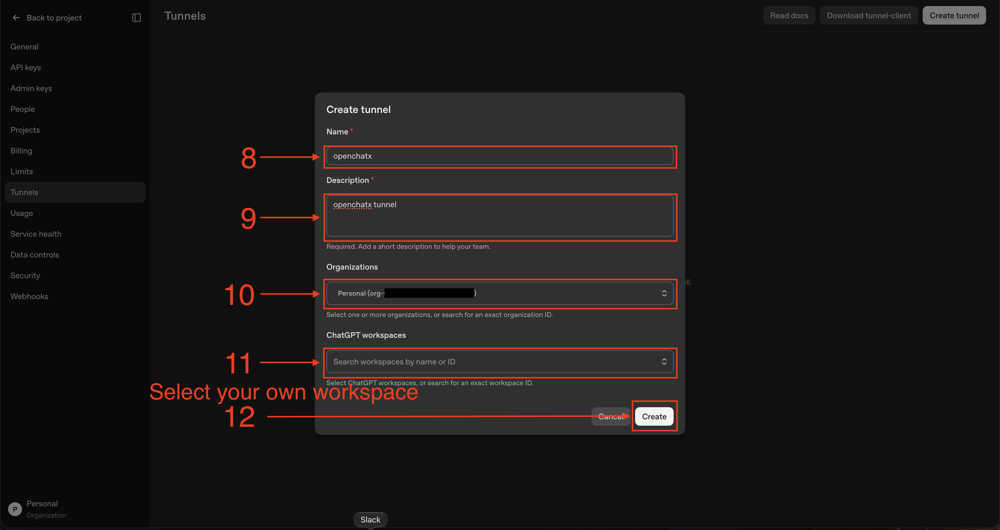
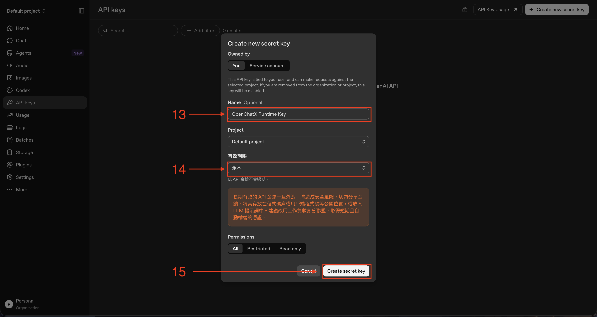
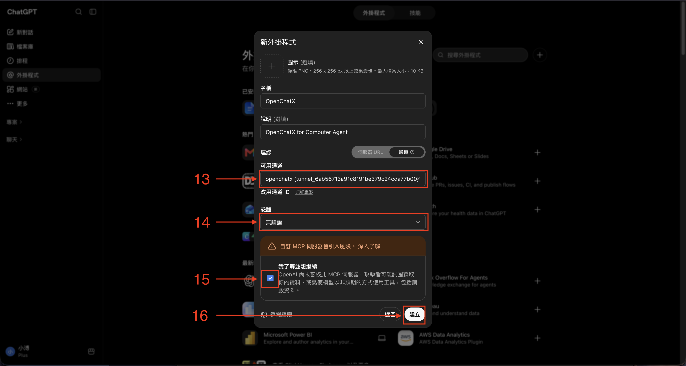
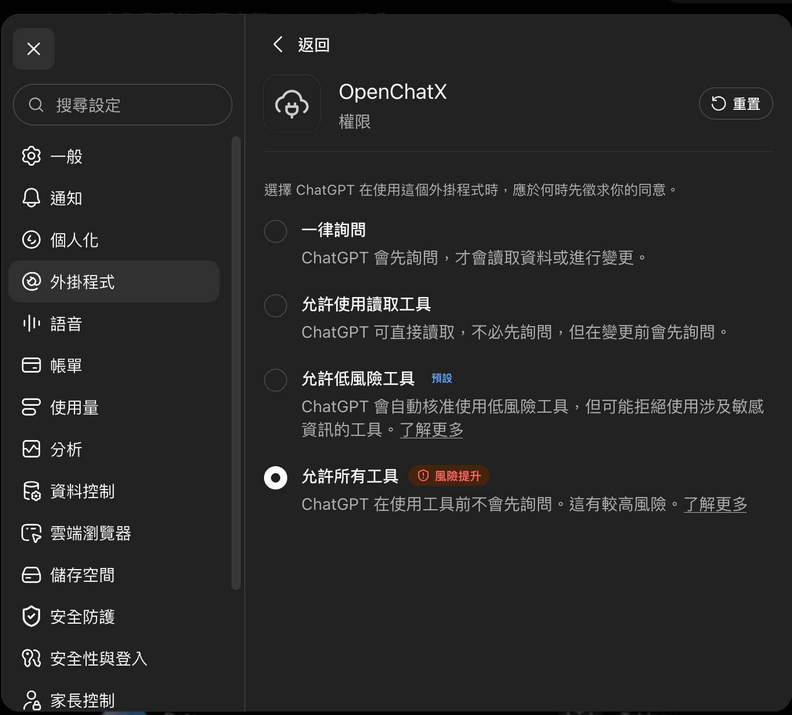

<p align="center">
  
</p>

<h1 align="center">OpenChatX</h1>

<p align="center">
  <strong>English</strong> · <a href="README.zh-TW.md">繁體中文</a>
</p>

<p align="center">
  <strong>Build your own ChatGPT agent workflow — without building the agent runtime from scratch.</strong><br>
  OpenChatX is a batteries-included, fully customizable local agent platform: coding-grade file and shell tools, computer control, MCP aggregation, Skills, Rules, Projects, Tasks, Subagents, cross-session Summaries, and more — all exposed through one official ChatGPT MCP connection, with Toolboxes to customize how your agent works.
</p>

<p align="center">
  <a href="https://github.com/XiaoPuOuO/openchatx-mcp/releases/latest"><strong>Download latest release</strong></a>
</p>

<p align="center">
  <a href="https://m8ven.ai/mcp/xiaopuouo/openchatx-mcp"></a>
  <a href="https://aiagentslisting.com/mcp/openchatx-mcp"></a>
</p>

> [!IMPORTANT]
> OpenChatX runs through regular **ChatGPT Chat**. It does **not** consume your ChatGPT Work / Codex agentic allowance. If your Work or Codex allowance is exhausted, you can still use OpenChatX as long as your normal Chat usage is available.

> [!CAUTION]
> OpenChatX runs with your local user permissions. A trusted ChatGPT caller can run commands, edit files, use connected MCP servers, and control supported applications.

## How it works — official MCP, no reverse engineering

OpenChatX uses OpenAI's **documented MCP integration path**. It does not reverse-engineer ChatGPT, call undocumented ChatGPT backend endpoints, reuse browser session cookies, or intercept ChatGPT traffic.

The connection works like this:

1. **OpenChatX runs a normal MCP server locally** on your machine.
2. **OpenAI's official `tunnel-client` creates an outbound HTTPS connection** to an OpenAI Secure MCP Tunnel. Your local MCP server does not need a public inbound port.
3. **ChatGPT connects to that tunnel as a custom MCP app** using the supported ChatGPT Developer Mode / MCP app flow.
4. When ChatGPT invokes a tool, the Secure MCP Tunnel forwards the MCP request to OpenChatX locally and returns the MCP response through the same official channel.
5. OpenChatX then routes that request to local tools, your computer, connected MCP servers, Skills, Rules, Projects, or explicitly configured Subagents.

ChatGPT remains the model and planner. OpenChatX is the local tool/runtime layer; it does not impersonate ChatGPT or make hidden model calls on ChatGPT's behalf.

The Runtime API key configured in OpenChatX is used for the official Secure MCP Tunnel control plane and is stored in the operating-system credential store. It is not a scraped ChatGPT credential or a workaround around ChatGPT's supported interfaces.

Official references:

- OpenAI Secure MCP Tunnel: https://developers.openai.com/api/docs/guides/secure-mcp-tunnels
- ChatGPT Developer Mode and MCP apps: https://help.openai.com/en/articles/12584461-developer-mode-and-mcp-apps-in-chatgpt

## Install the Desktop App

This is the recommended way to use OpenChatX. You do **not** need to install Node.js, npm, PM2, or `tunnel-client` yourself.

### macOS

Download the matching DMG from the latest release:

- Apple Silicon: `OpenChatX-macos-arm64.dmg`
- Intel Mac: `OpenChatX-macos-x64.dmg`

The macOS release is signed with Developer ID and notarized by Apple.

### Windows

For most PCs, download:

- `OpenChatX-Setup-x64.exe`

For Windows on ARM:

- `OpenChatX-Setup-arm64.exe`

Portable ZIPs are also available.

> [!WARNING]
> **Windows may warn because the binary is unsigned.**
> The Windows build is currently distributed without Authenticode signing. Download it only from this repository's GitHub Releases page.

Latest release:

https://github.com/XiaoPuOuO/openchatx-mcp/releases/latest

## Connect OpenChatX to ChatGPT

OpenChatX uses OpenAI Secure MCP Tunnel. The Desktop App manages the local runtime and bundled `tunnel-client`; you only need to create the tunnel once.

### 1. Create the ChatGPT MCP app

> **The Developer Mode toggle currently appears to be missing from ChatGPT.** Some users have reported that they can create an MCP app without enabling Developer Mode, so for now, skip this step and continue directly with the Plugins flow below.

Then open **Plugins**, click **+**, choose **Create app**, and then choose **Create MCP app**.





Enter the app name and description, switch the connection type to **Tunnel**, and click **Create tunnel**.



### 2. Create the tunnel in OpenAI Platform

Open the OpenAI Platform Tunnels page:

https://platform.openai.com/settings/organization/tunnels

Click **Create tunnel**, then configure:

1. **Name** — for example, `OpenChatX Tunnel`.
2. **Description** — for example, `OpenChatX Tunnel`.
3. **Organizations** — select the organization that should own the tunnel.
4. **ChatGPT workspaces** — select the ChatGPT workspace that will use OpenChatX.
5. Click **Create**.



After creation, copy the resulting `tunnel_...` ID. You will enter this in OpenChatX Desktop.

### 3. Create the Runtime API key

Open the OpenAI Platform API Keys page:

https://platform.openai.com/settings/organization/api-keys

Create a new secret key for the OpenChatX tunnel runtime. A name such as `OpenChatX Runtime Key` makes it easier to identify later.



Copy the secret when it is shown. Do not commit it to Git or paste it into chat.

### 4. Connect the Desktop App

Open OpenChatX Desktop → **More → Connect Tunnel…**

Enter:

- **Tunnel ID** — the `tunnel_...` ID from step 2.
- **Control-plane API key** — the Runtime API key from step 3.

The Desktop App stores the API key in the operating-system credential store:
- macOS: Keychain
- Windows: Credential Manager

### 5. Finish the ChatGPT MCP app

Return to ChatGPT:

1. Select the newly created `openchatx (tunnel_...)` tunnel.
2. Set authentication to **No authentication**.
3. Read and accept the custom MCP risk acknowledgement.
4. Click **Create**.



If you want ChatGPT to use OpenChatX tools without prompting for every tool call, you can set the OpenChatX app permission to **Allow all tools**.



Useful links:

- OpenAI Secure MCP Tunnel guide: https://developers.openai.com/api/docs/guides/secure-mcp-tunnels
- OpenAI Tunnels settings: https://platform.openai.com/settings/organization/tunnels
- OpenAI API keys: https://platform.openai.com/settings/organization/api-keys

## What OpenChatX gives ChatGPT

| Feature | What it does |
| --- | --- |
| MCP Servers | Connect local or remote MCP servers behind one OpenChatX connection, sign in with OAuth when needed, and enable or disable individual tools |
| Runtime health | Check capability status, sign-in requirements, and memory usage from the Dashboard |
| Toolboxes | Add or manage custom TypeScript tools |
| Skills | Portable `SKILL.md` workflows, loaded only when needed |
| Rules | Persistent `.mdc` rules with Always / Auto Attached / Agent Requested / Manual modes |
| AGENTS.md | Editable `start_here` template with runtime placeholders |
| Projects | Bind work to a primary folder and optional additional folders, with workspace-scoped access |
| Goals & workflows | Track longer-running tasks and compose reusable capabilities |
| Summaries | Continue long-running work across fresh ChatGPT conversations with UUID handoffs |
| Subagents | Run independent, tool-using agents in parallel or nested sessions; follow their progress, guide them, and manage approvals |
| Model providers | Configure ChatGPT account access, Anthropic, Gemini, OpenAI, or OpenAI-compatible and local model endpoints |
| Permissions | Choose an access mode, review sensitive actions, and pause agent access when necessary |
| Mobile Dashboard | Use the responsive Dashboard on your phone, optionally through a private Tailscale connection |
| Capability Store | Install built-ins or inspect/install GitHub-hosted community capabilities |
| Dashboard | Manage ChatGPT and Subagent sessions, temporary Summaries, tools, Skills, Rules, MCP servers, Projects, and system status |
| Languages | English, Traditional Chinese, Japanese, Russian, and Vietnamese interface translations |

### Subagents and model providers

Subagents can work on separate tasks with their own conversation histories and access to the enabled OpenChatX tools. Delegate work synchronously or asynchronously, run independent jobs in parallel, or allow subagents to delegate further within configured limits. You can keep using the main chat while asynchronous work runs.

From **Dashboard → Subagents**, connect a supported provider, discover available models, and create model profiles. Options include ChatGPT account sign-in (when your account permits it), Anthropic, Gemini, OpenAI, and OpenAI-compatible APIs, including local model servers. Set each profile's reasoning controls and context/output limits where supported. Under **Settings → Subagents**, set the maximum delegation depth and number of children per agent.

Open **Subagent Sessions** to follow each session's messages and tool calls, send guidance while it runs, continue a finished session with new instructions, handle tool approvals, or delete a session and its descendants. Subagents follow the same OpenChatX access and approval boundaries as the parent agent.

### Access the Dashboard from your phone with Tailscale

You can use the responsive OpenChatX Dashboard from another device on your private Tailscale network without exposing the MCP endpoint to the public internet:

1. Install and connect Tailscale yourself on your computer and phone, using the same tailnet.
2. Open **OpenChatX → Settings → General → Tailscale mobile access**, enable it, and enter this computer's Tailscale IPv4 address.
3. On your phone, visit `http://<TAILSCALE-IP>:8001/ui/` (replace `8001` if you changed the Runtime port).

OpenChatX manages the internal proxy port and Tailscale Serve mapping automatically, including reconnect recovery. You do not need to configure a separate proxy port. Only `/ui` is forwarded; `/mcp` remains blocked. The Dashboard can perform administrative actions, so restrict which devices can reach it through your tailnet access policies. Tailscale is not installed or signed in by OpenChatX. See [Tailscale mobile access](wiki/pages/operations/tailscale-mobile-access.md).

### Access modes and recovery

Under **Settings → Trust**, choose **Always Question** (ask before tool actions), **Allow Low Risk** (allow low-risk actions and request approval for higher-risk ones), or **Full Access** (bypass ordinary approval boundaries; use only on a trusted computer). Approval requests can be approved once, allowed for an operation, or denied. You can pause agent access from the Dashboard and use Safe Mode to recover from problematic extensions. These OpenChatX controls are separate from ChatGPT's MCP app permission settings.

### Suggested Dot preferences for ChatGPT Pro users

If your ChatGPT Pro account has access to Dots, ask your Dot to save the following as your working preferences when collaborating with OpenChatX. This configures **Dot's behavior**, not a separate OpenChatX Dot listener or tunnel; actual tool access still depends on your connected apps and permissions.

```text
Communication
- Be concise and lead with the answer. Skip greetings and restating the question.
- Clearly distinguish verified information, inference, and unconfirmed details. Never present a guess as fact.
- Start with a summary; expand when details are useful. Avoid generic, overconfident, AI-sounding copy.
- Stay quiet when there is nothing to do or report. Describe progress accurately.

Working style
- After receiving an assignment, continue working toward completion. A progress update does not mean the work is finished; do not wait to be reminded.
- When one part is blocked, continue independent work. Do not duplicate work that another agent is doing or has completed.
- Focus on the requested outcome and use sufficient direct verification. Avoid repeated investigations, audits, and endless confirmation loops.
- Do not create unnecessary backups, parallel versions, temporary scripts, or reports. Preserve necessary results and safely clean up your temporary files.
- Make changes only when they offer a concrete benefit; do not create changes simply to appear busy.

Tools
- Unless explicitly requested, do not switch to Work mode. Prefer creating your own parallel subagents and letting them use OpenChatX capabilities; minimize direct OpenChatX use.
- Parallel subagents are allowed when responsibilities are separated and their work cannot overwrite one another. Report whether they are actually running.

Other
- Work on multiple projects concurrently without letting them block one another. Never push, merge, deploy, or use real customer data without explicit authorization.
```

### MCP sign-in and status

Remote MCP connections can use OAuth when the server requires sign-in. OpenChatX surfaces an authorization prompt and connection status in the MCP management UI, and stores OAuth credentials in the OS secure store instead of the MCP configuration. The Dashboard also distinguishes authentication-required services from runtime failures.

External MCP and Toolbox schemas stay lazy so the normal ChatGPT tool context stays small.

## Cross-session Summaries

A key OpenChatX differentiator is that long-running Agent work can survive the ChatGPT conversation itself. When a chat eventually hits practical context limits, OpenChatX provides a handoff layer instead of forcing you to reconstruct the task manually.

When the Agent calls `summarize`, it stores two parts locally:

- a compacted summary of older context;
- roughly the latest 8k tokens of useful recent conversation, kept separately when practical.

OpenChatX returns a UUID. Start a fresh ChatGPT conversation, give the Agent that UUID, and `summarize` returns the stored summary plus recent context. The handoff is then deleted automatically.

Temporary summaries can also be viewed, created, edited, copied, or deleted from the Dashboard.

## Skills, Rules, and AGENTS.md

### Skills

Skills are portable Agent Skills owned by a Toolbox:

```text
toolboxes/<toolbox>/skills/<name>/SKILL.md
```

A Skill contains `name`, `description`, and Markdown instructions. Skills are not injected at startup.

- `skill_search` finds up to five relevant Skills by name/description; use `action=load` with an exact Skill name to load its full Markdown.
- `skill_manage` creates, edits, or deletes user Skills.

### Rules

Rules are owned by a Toolbox and live beside that Toolbox's other capabilities:

```text
toolboxes/<toolbox>/rules/<name>.mdc
```

Example:

```md
---
description: "React component conventions"
globs:
  - "src/**/*.tsx"
alwaysApply: false
---

Use accessible labels and named exports.
```

OpenChatX supports four Rule modes:

- **Always** — injected by `start_here`.
- **Auto Attached** — activated by matching file globs.
- **Agent Requested** — selected from the description when relevant.
- **Manual** — loaded only when explicitly requested.

Rules can be imported/exported with Cursor `.mdc`, Claude Rules, and `AGENTS.md`.

### AGENTS.md

`~/.openchatx-mcp/AGENTS.md` is the editable template used by `start_here`.

The Toolbox UI exposes it directly. Runtime data is inserted through placeholders such as:

- `{{MODE_INSTRUCTIONS}}`
- `{{PROJECT_CONTEXT}}`
- `{{CAPABILITY_CATALOG}}`
- `{{ALWAYS_RULES}}`

Move or remove placeholders to control what `start_here` returns.

## Connect more capabilities

You can usually just ask ChatGPT:

> Add this MCP server to OpenChatX and verify it works.

or:

> Create an OpenChatX tool that starts my local service and returns its status.

OpenChatX can manage MCP servers, Toolboxes, Skills, Rules, Projects, and Subagents from the Dashboard or through its management tools.

## Manual / source install

Use this only if you do not want the Desktop App.

### Requirements

- Node.js 22.18+
- npm
- ripgrep
- OpenAI `tunnel-client`
- ChatGPT Developer Mode / custom MCP access

### macOS

```bash
brew install ripgrep
git clone https://github.com/XiaoPuOuO/openchatx-mcp.git
cd openchatx-mcp
npm ci
npm run setup -- --config-only
```

### Windows PowerShell

```powershell
winget install BurntSushi.ripgrep.MSVC
git clone https://github.com/XiaoPuOuO/openchatx-mcp.git
Set-Location openchatx-mcp
npm ci
npm run setup -- --config-only
```

Then install the official OpenAI `tunnel-client`, create the `openchatx` tunnel profile, export `CONTROL_PLANE_API_KEY`, and run:

```bash
npm run setup
npm start
```

Useful commands:

| Command | Purpose |
| --- | --- |
| `npm run status` | Show runtime/tunnel status |
| `npm run logs` | Show runtime logs |
| `npm run print-url` | Print local MCP/UI/tunnel URLs |
| `npm run restart` | Rebuild and reload services |
| `npm run stop` | Stop managed services |
| `npm run auth:reset` | Clear the bound ChatGPT subject |

## Development

```bash
npm ci
npm --prefix ui ci
npm run lint
npm run typecheck
npm test
npm run build
npm --prefix ui run build
```

Desktop build commands:

```bash
npm run desktop:build
npm run desktop:smoke
npm run desktop:windows:build
npm run desktop:windows:build:arm64
```

Maintainer docs: [wiki/](wiki/)

## Security

- Only connect MCP servers you trust.
- The local MCP endpoint is intended to stay on loopback.
- Secure MCP Tunnel is the supported remote path.
- Tool/audit logs may contain sensitive inputs.
- See [SECURITY.md](SECURITY.md) for the security model and reporting instructions.

## License

MIT — see [LICENSE](LICENSE).

Parts of this project are derived from [Shellby MCP](https://github.com/Serbyte-Development/shellby-mcp); see [THIRD_PARTY_NOTICES.md](THIRD_PARTY_NOTICES.md).
