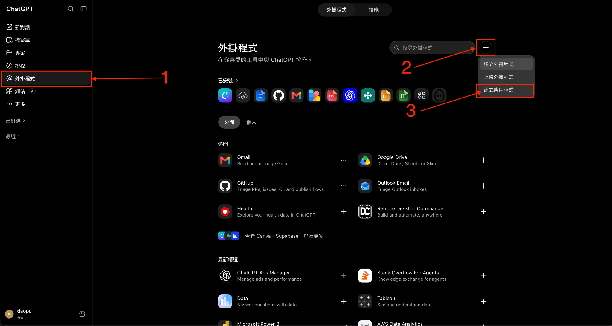
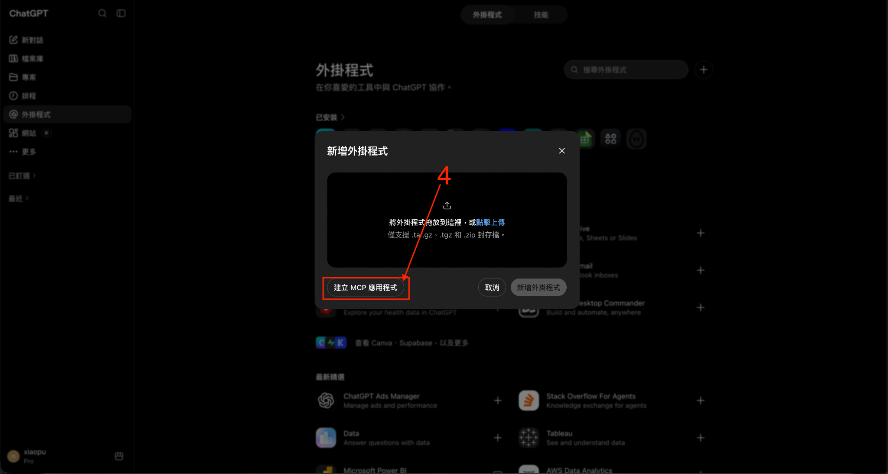
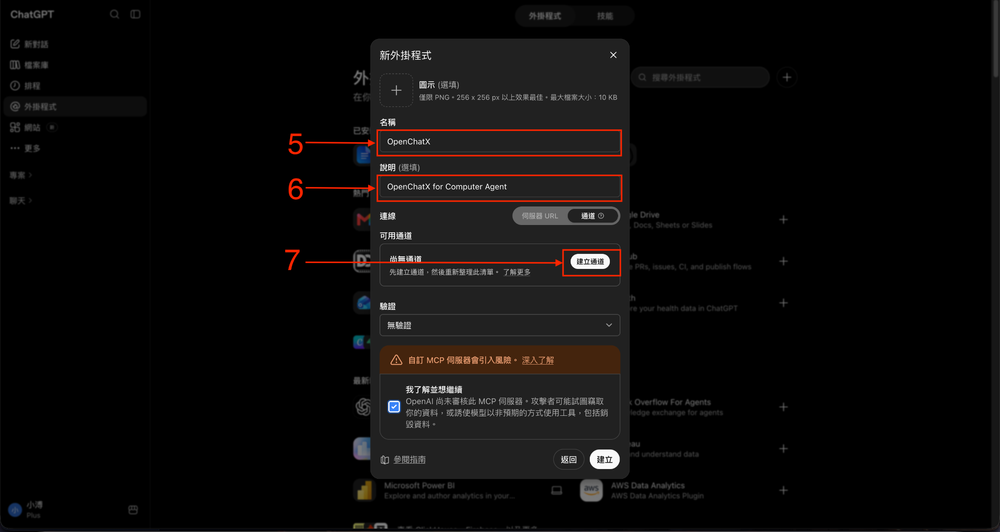
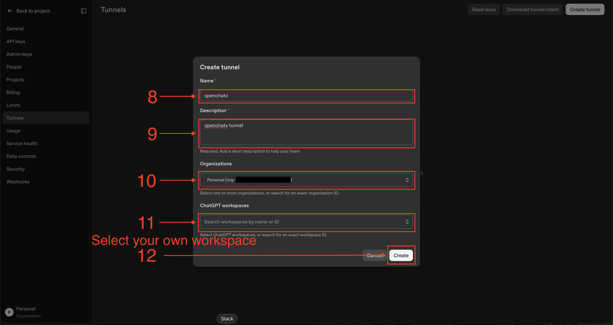
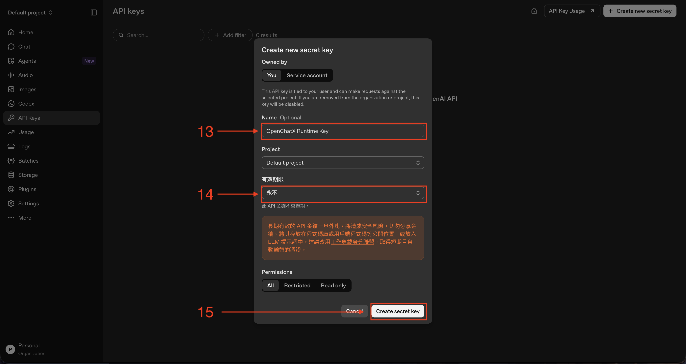
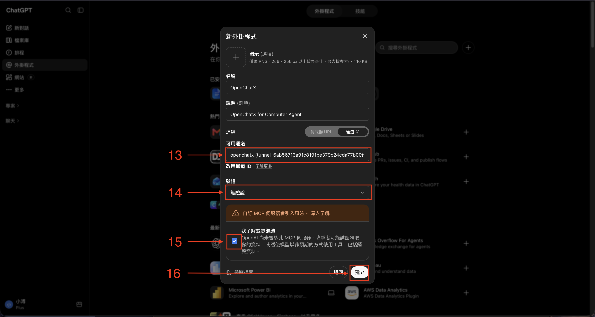
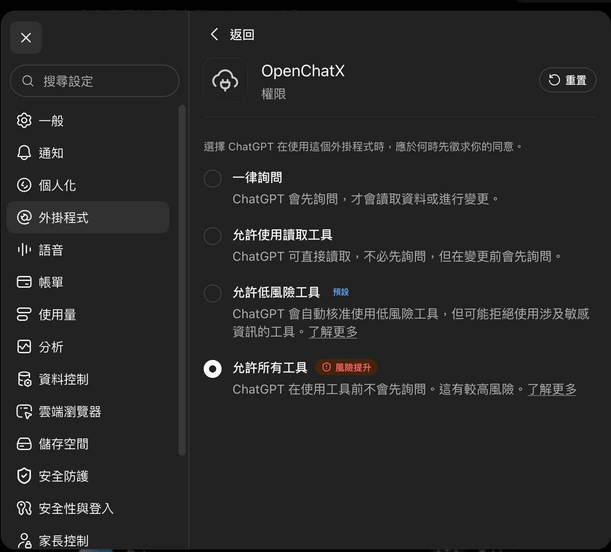

<p align="center">
  
</p>

<h1 align="center">OpenChatX</h1>

<p align="center">
  <a href="README.md">English</a> · <strong>繁體中文</strong>
</p>

<p align="center">
  <strong>打造你自己的 ChatGPT Agent Workflow，不需要從零開始重做一套 Agent Runtime。</strong><br>
  OpenChatX 是一個 batteries-included、可高度自訂的本機 Agent 平台：內建 Coding Agent 所需的檔案、Shell、電腦控制、MCP 聚合、Skills、Rules、Projects、Tasks、Subagents、跨對話 Summaries 等能力，再透過 Toolboxes 讓你自由改造 Agent 的工具、規則與工作流程；全部只需要一條官方 ChatGPT MCP 連線。
</p>

<p align="center">
  <a href="https://github.com/XiaoPuOuO/openchatx-mcp/releases/latest"><strong>下載最新版</strong></a>
</p>

> [!IMPORTANT]
> OpenChatX 使用的是一般 **ChatGPT Chat** 的用量，**不會消耗 ChatGPT Work / Codex 的 Agent 額度**。就算 Work 或 Codex 額度已經用完，只要一般 Chat 還有可用額度，就可以繼續使用 OpenChatX。

> [!CAUTION]
> OpenChatX 會以你目前作業系統使用者的權限執行。已授權的 ChatGPT 可以執行指令、編輯檔案、使用已連接的 MCP Servers，並控制支援的應用程式。

## 運作方式：官方 MCP，不是逆向工程

OpenChatX 使用 OpenAI **官方、文件化的 MCP 整合方式**。它不會逆向 ChatGPT、不會呼叫未公開的 ChatGPT 後端 API、不會重用瀏覽器 Session Cookie，也不會攔截 ChatGPT 的網路流量。

實際連線流程如下：

1. **OpenChatX 在你的電腦上執行標準 MCP Server**。
2. **OpenAI 官方 `tunnel-client` 主動建立對外 HTTPS 連線**到 OpenAI Secure MCP Tunnel，因此不需要替本機 MCP Server 開放公開的 inbound port。
3. **ChatGPT 透過官方 Developer Mode / MCP App 流程連上這條 Tunnel**。
4. ChatGPT 呼叫工具時，Secure MCP Tunnel 會把 MCP Request 轉送到本機 OpenChatX，再透過同一條官方通道把 MCP Response 回傳。
5. OpenChatX 再把請求路由到本機工具、電腦、已連接的 MCP Servers、Skills、Rules、Projects，或你明確設定的 Subagents。

ChatGPT 本身仍然是模型與 Planner；OpenChatX 是本機的工具與 Runtime Layer。OpenChatX 不會假冒 ChatGPT，也不會偷偷替 ChatGPT 呼叫隱藏的模型 API。

OpenChatX Desktop 內設定的 Runtime API Key 只用於官方 Secure MCP Tunnel 的 Control Plane，並儲存在作業系統的 Credential Store。它不是從 ChatGPT 擷取出來的憑證，也不是繞過 ChatGPT 官方介面的手段。

官方文件：

- OpenAI Secure MCP Tunnel：https://developers.openai.com/api/docs/guides/secure-mcp-tunnels
- ChatGPT Developer Mode and MCP apps：https://help.openai.com/en/articles/12584461-developer-mode-and-mcp-apps-in-chatgpt

## 優先：安裝 Desktop App

這是建議的使用方式。你**不需要**自己安裝 Node.js、npm、PM2 或 `tunnel-client`。

### macOS

到最新 Release 下載：

- Apple Silicon：`OpenChatX-macos-arm64.dmg`
- Intel Mac：`OpenChatX-macos-x64.dmg`

macOS Release 會使用 Developer ID 簽章並提交 Apple Notarization。

### Windows

一般 Windows 電腦下載：

- `OpenChatX-Setup-x64.exe`

Windows on ARM 下載：

- `OpenChatX-Setup-arm64.exe`

也有 Portable ZIP 可用。

> [!WARNING]
> **Windows may warn because the binary is unsigned.**
> 目前 Windows 版本沒有 Authenticode 簽章，因此 Windows 可能顯示 SmartScreen 警告。請只從本專案的 GitHub Releases 下載。

最新版：

https://github.com/XiaoPuOuO/openchatx-mcp/releases/latest

## 連接到 ChatGPT

OpenChatX 使用 OpenAI Secure MCP Tunnel。Desktop App 已經內建本機 Runtime 與 `tunnel-client`，只需要設定一次 Tunnel。

### 1. 在 ChatGPT 建立 MCP App

> **目前 ChatGPT 裡的 Developer Mode 開關似乎已經不見了。** 有使用者回報，即使沒有開啟 Developer Mode 也可以直接建立 MCP App，所以目前請先跳過開啟 Developer Mode 這個階段，直接從下面的 Plugins 建立 MCP App 流程開始。

接著打開 **Plugins**，按 **+**，選 **Create app**，再選 **Create MCP app**。





填入 App 名稱與說明，把 Connection Type 切成 **Tunnel**，然後按 **Create tunnel**。



### 2. 在 OpenAI Platform 建立 Tunnel

打開 OpenAI Platform 的 Tunnels 頁面：

https://platform.openai.com/settings/organization/tunnels

按右上角 **Create tunnel**，然後設定：

1. **Name** — 例如 `OpenChatX Tunnel`。
2. **Description** — 例如 `OpenChatX Tunnel`。
3. **Organizations** — 選擇要擁有這個 Tunnel 的 Organization。
4. **ChatGPT workspaces** — 選擇要使用 OpenChatX 的 ChatGPT Workspace。
5. 按 **Create**。



建立完成後，複製產生的 `tunnel_...` ID。等等要填進 OpenChatX Desktop。

### 3. 建立 Runtime API Key

打開 OpenAI Platform 的 API Keys 頁面：

https://platform.openai.com/settings/organization/api-keys

建立一把給 OpenChatX Tunnel Runtime 使用的 Secret Key。建議名稱用 `OpenChatX Runtime Key`，之後比較容易辨識。



Secret 只會完整顯示一次，請先複製保存。不要 commit 到 Git，也不要貼進 ChatGPT 對話。

### 4. 在 Desktop App 連接 Tunnel

打開 OpenChatX Desktop → **More → Connect Tunnel…**

填入：

- **Tunnel ID** — 第 2 步取得的 `tunnel_...` ID。
- **Control-plane API key** — 第 3 步建立的 Runtime API Key。

Desktop App 會把 API Key 存在系統安全儲存區：
- macOS：Keychain
- Windows：Credential Manager

### 5. 回到 ChatGPT 完成 MCP App

回到 ChatGPT：

1. 選擇剛建立的 `openchatx (tunnel_...)` Tunnel。
2. Authentication 選 **No authentication**。
3. 閱讀並接受 Custom MCP 的風險提示。
4. 按 **Create** 完成建立。



如果希望 ChatGPT 使用 OpenChatX Tools 時不要每次都詢問，也可以把 OpenChatX App 權限設成 **Allow all tools**。



相關連結：

- OpenAI Secure MCP Tunnel：https://developers.openai.com/api/docs/guides/secure-mcp-tunnels
- Tunnel 設定：https://platform.openai.com/settings/organization/tunnels
- API Keys：https://platform.openai.com/settings/organization/api-keys

## OpenChatX 提供什麼

| 功能 | 用途 |
| --- | --- |
| MCP Servers | 集中管理本機或遠端 MCP Server，支援 OAuth 登入，並可個別啟用或停用工具 |
| 系統健康狀態 | 從 Dashboard 查看能力狀態、登入需求及記憶體使用情況 |
| Toolboxes | 管理內建與自訂 TypeScript 工具 |
| Skills | 可攜的 `SKILL.md` 工作流程，需要時才載入 |
| Rules | `.mdc` 規則，支援 Always / Auto Attached / Agent Requested / Manual |
| AGENTS.md | 可直接編輯的 `start_here` Prompt 範本 |
| Projects | 綁定主要與附加資料夾，依 Workspace 權限界線存取 |
| Goals 與 Workflows | 追蹤較長時間的任務，組合可重複使用的工作流程 |
| Summaries | 透過 UUID 將長時間工作交接到新的 ChatGPT 對話 |
| Subagents | 平行或巢狀執行獨立 Agent，查看進度、補充指導並管理審批 |
| 模型供應商 | 設定 ChatGPT 帳號、Anthropic、Gemini、OpenAI、OpenAI 相容 API 或本地模型 |
| 權限管理 | 選擇存取模式、核准敏感操作，必要時暫停 Agent 存取 |
| 手機版 Dashboard | 使用響應式介面，亦可透過私人 Tailscale 網路從手機存取 |
| Capability Store | 安裝內建能力，或檢查後安裝 GitHub 社群能力 |
| Dashboard | 管理 ChatGPT／Subagent 工作階段、暫存 Summaries、Tools、Skills、Rules、MCP、Projects 與系統狀態 |
| 多語系 | 英文、繁體中文、日文、俄文與越南文介面翻譯 |

### Subagents 與模型供應商

Subagents 能各自保有對話與執行紀錄，並使用已啟用的 OpenChatX 工具。可以同步交辦、非同步執行多個任務，也能在設定的限制內繼續委派給下一層 Agent。非同步任務進行時，主對話仍可處理其他工作。

從 **Dashboard → Subagents** 連接供應商、探索可用模型並建立模型設定。支援符合帳號權限的 ChatGPT 登入、Anthropic、Gemini、OpenAI，以及 OpenAI 相容 API（包含本地模型）。可依模型能力設定 Thinking、Context Window 與輸出長度；到 **Settings → Subagents** 調整最大委派深度及每個 Agent 可建立的子代理數量。

在 **Subagent Sessions** 可以查看每個 Agent 的訊息與工具呼叫、執行進度，隨時補充指導、接續已完成的工作、處理工具審批，或刪除工作階段及其底下的子代理工作階段。子代理同樣受到 OpenChatX 的工具權限與審批規則約束。

### 用 Tailscale 從手機開啟 Dashboard

手機可透過私人 Tailscale 網路使用響應式 Dashboard，不必把 MCP 對外公開：

1. 自行在電腦與手機安裝 Tailscale，並連入同一個 tailnet。
2. 在 **OpenChatX → Settings → General → Tailscale mobile access** 開啟功能，輸入這台電腦的 Tailscale IPv4。
3. 在手機開啟 `http://<TAILSCALE-IP>:8001/ui/`。若 Runtime 使用其他 Port，則將 `8001` 換成實際的 Runtime Port。

OpenChatX 會自動分配內部代理 Port、管理 Tailscale Serve 轉送並在失去連線後嘗試恢復，不需要另外設定代理 Port。遠端只開放 `/ui`，不開放 `/mcp`。由於 Dashboard 也能進行管理操作，請用 tailnet 存取規則限制可連線的裝置。OpenChatX 不會代替使用者安裝或登入 Tailscale。詳細步驟請看 [Tailscale 手機存取](wiki/pages/operations/tailscale-mobile-access.md)。

### 權限模式與復原

到 **Settings → Trust** 選擇 **Always Question**（執行操作前詢問）、**Allow Low Risk**（低風險操作可直接執行，較高風險操作需要審批）或 **Full Access**（略過一般審批限制，僅建議在可信任的電腦上使用）。審批可選單次允許、允許指定操作或拒絕。Dashboard 亦可暫停 Agent 存取，遇到擴充能力問題時可使用 Safe Mode 復原。這些權限與 ChatGPT MCP App 的授權是不同層次。

### ChatGPT Pro 使用者：建議設定 Dot 偏好

如果你的 ChatGPT Pro 帳號可以使用 Dots，建議請 Dot 將以下內容存成與 OpenChatX 協作時的使用者偏好。這是 **Dot 的工作方式建議**，不代表 OpenChatX 另有 Dot 專用 Listener 或 Tunnel；能使用哪些工具仍取決於實際連接與授權。

```text
溝通
- 精簡、先講答案，不要開場白或重述問題。
- 已驗證、推測和未確認的事要分清楚；不能把猜測當事實。
- 優先給摘要，需要細節時再展開；不要寫空泛、武斷或很有 AI 味的文案。
- 沒有需要處理或回報的事就保持安靜；進度要如實說明。

工作方式
- 交辦後持續推進，階段回報不等於全部完成，不要等你催才繼續。
- 一部分卡住時，繼續處理不受影響的部分；不要重複別人正在做或已做完的工作。
- 聚焦完成結果，用足夠的直接驗證即可，避免反覆調查、審查和為了確定而無限延伸。
- 不要無必要地建立備份、平行版本、暫存腳本或報告；保留必要成果，安全清理自己產生的暫存。
- 有明確收益才修改，不為了看起來有在工作而湊改動。

工具
- 除非用戶明確要求，否則不要切換 Work mode，應建立自己的可平行工作的subagent並讓他們使用OpenChatX來獲取能力，儘量不要自己使用OpenChatX。
- 可以多個 subagent 並行，但要分工、避免互相覆蓋，也要如實回報是否真的在工作。

其他
- 可並行處理多個專案，需避免互相卡住；不得擅自推送、合併、部署或使用真實客戶資料。
```

### MCP OAuth 登入與狀態

遠端 MCP Server 需要登入時可透過 OAuth 授權，OpenChatX 會在 MCP 管理介面顯示授權提示與連線狀態。OAuth 憑證儲存在作業系統的安全儲存區，不會寫入 MCP 設定檔。Dashboard 也會區分「需要登入」與 Runtime 本身的故障。

外部 MCP 與 Toolbox Tool Schema 採 lazy discovery，不會一開始全部塞進 ChatGPT Context。

## 跨對話 Summaries

這是 OpenChatX 的核心差異化之一：長時間執行的 Agent 任務不需要跟著目前這個 ChatGPT 對話一起結束。當對話最終遇到 Context 過長限制時，OpenChatX 會提供交接層，不需要使用者自己重新整理整個任務背景。

Agent 呼叫 `summarize` 時，OpenChatX 會在本機暫存兩部分：

- 較舊 Context 的壓縮摘要；
- 最近約 8k tokens 的有用對話，能保留原文時就另外保留。

OpenChatX 接著回傳一個 UUID。開啟新的 ChatGPT 對話後，把這個 UUID 交給 Agent，`summarize` 就會把壓縮摘要與最近上下文一起取回；成功取出後，這份暫存摘要會自動刪除。

Dashboard 也可以直接查看、建立、編輯、複製 UUID 或刪除暫存摘要。

## Skills、Rules、AGENTS.md

### Skills

Skill 使用標準 Agent Skills 格式，並由 Toolbox 擁有：

```text
toolboxes/<toolbox>/skills/<name>/SKILL.md
```

Skill 只有 `name`、`description` 與 Markdown Instructions，不會在 Startup 預先注入。

- `skill_search`：依名稱與說明搜尋，最多回傳 5 個；選定後用 `action=load` 搭配完整 Skill 名稱載入 Markdown。
- `skill_manage`：新增、編輯、刪除 Skill。

### Rules

Rule 由 Toolbox 擁有，和該 Toolbox 的其他能力放在一起：

```text
toolboxes/<toolbox>/rules/<name>.mdc
```

例如：

```md
---
description: "React component conventions"
globs:
  - "src/**/*.tsx"
alwaysApply: false
---

Use accessible labels and named exports.
```

支援四種模式：

- **Always** — 由 `start_here` 自動注入。
- **Auto Attached** — 依 File Glob 自動套用。
- **Agent Requested** — Agent 依 description 判斷是否需要。
- **Manual** — 只有明確指定時才載入。

Rules 可以和 Cursor `.mdc`、Claude Rules、`AGENTS.md` 匯入 / 匯出。

### AGENTS.md

`~/.openchatx-mcp/AGENTS.md` 是 `start_here` 實際使用的可編輯範本。

工具箱 UI 可以直接編輯它。動態內容透過佔位符注入，例如：

- `{{MODE_INSTRUCTIONS}}`
- `{{PROJECT_CONTEXT}}`
- `{{CAPABILITY_CATALOG}}`
- `{{ALWAYS_RULES}}`

移動或刪除佔位符，就能直接控制 `start_here` 最後回傳的 Prompt。

## 連接更多能力

通常直接跟 ChatGPT 說就可以：

> 幫我把這個 MCP Server 加進 OpenChatX 並驗證能用。

或：

> 幫我做一個 OpenChatX Tool，可以啟動我的本機服務並回傳狀態。

你也可以從 Dashboard 手動管理 MCP Servers、Toolboxes、Skills、Rules、Projects 與 Subagents。

## 進階：不安裝 Desktop App

只有在你想從 Source 手動執行時才需要這一段。

### 需求

- Node.js 22.18+
- npm
- ripgrep
- OpenAI `tunnel-client`
- ChatGPT Developer Mode / Custom MCP 權限

### macOS

```bash
brew install ripgrep
git clone https://github.com/XiaoPuOuO/openchatx-mcp.git
cd openchatx-mcp
npm ci
npm run setup -- --config-only
```

### Windows PowerShell

```powershell
winget install BurntSushi.ripgrep.MSVC
git clone https://github.com/XiaoPuOuO/openchatx-mcp.git
Set-Location openchatx-mcp
npm ci
npm run setup -- --config-only
```

接著安裝官方 OpenAI `tunnel-client`、建立 `openchatx` Tunnel Profile、設定 `CONTROL_PLANE_API_KEY`，再執行：

```bash
npm run setup
npm start
```

常用指令：

| 指令 | 用途 |
| --- | --- |
| `npm run status` | 查看 Runtime / Tunnel 狀態 |
| `npm run logs` | 查看 Logs |
| `npm run print-url` | 顯示 MCP / UI / Tunnel URL |
| `npm run restart` | Rebuild 並重新載入 |
| `npm run stop` | 停止服務 |
| `npm run auth:reset` | 清除已綁定的 ChatGPT Subject |

## 開發

```bash
npm ci
npm --prefix ui ci
npm run lint
npm run typecheck
npm test
npm run build
npm --prefix ui run build
```

Desktop Build：

```bash
npm run desktop:build
npm run desktop:smoke
npm run desktop:windows:build
npm run desktop:windows:build:arm64
```

維護者文件：[wiki/](wiki/)

## 安全性

- 只連接你信任的 MCP Servers。
- Local MCP endpoint 應維持在 loopback。
- 遠端連線請使用 OpenAI Secure MCP Tunnel。
- Tool / Audit Logs 可能包含敏感輸入。
- 詳細安全模型與回報方式請看 [SECURITY.md](SECURITY.md)。

## License

MIT — 詳見 [LICENSE](LICENSE)。

本專案部分程式碼衍生自 [Shellby MCP](https://github.com/Serbyte-Development/shellby-mcp)，詳見 [THIRD_PARTY_NOTICES.md](THIRD_PARTY_NOTICES.md)。
